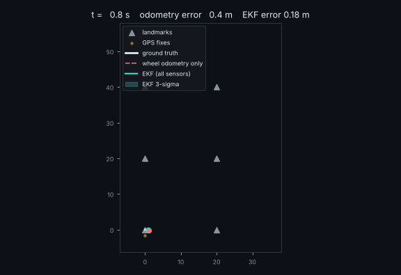
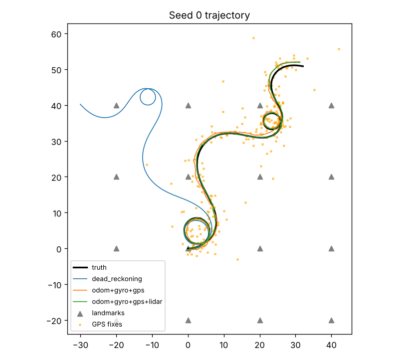
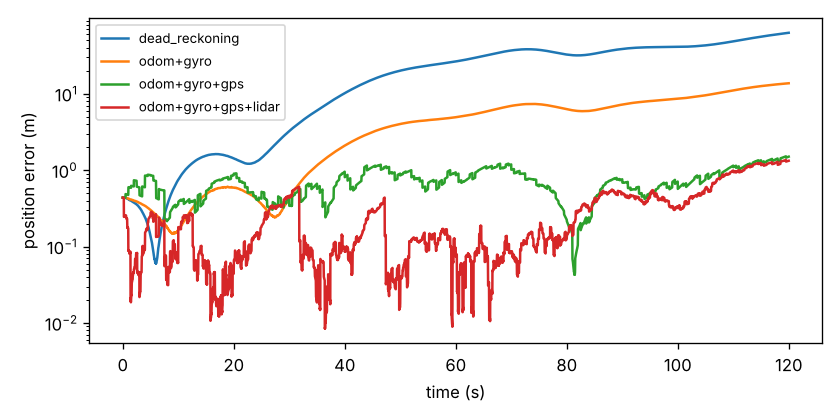

<p align="center">
  <picture>
    <source media="(prefers-color-scheme: dark)" srcset="media/banner-dark.svg">
    <source media="(prefers-color-scheme: light)" srcset="media/banner-light.svg">
    
  </picture>
</p>
<p align="center">
  <a href="https://github.com/Amatya27/ekf-sensor-fusion/actions/workflows/tests.yml"></a>
  
  
  
  
</p>

I built this to work through state estimation end to end: how a robot keeps track of where it is when every sensor it has is wrong in a different way.

The robot is a simulated differential-drive base. It has four sensors:

| Sensor | Rate | What goes wrong |
|---|---|---|
| Wheel odometry | 50 Hz | noisy, and a small turn-rate bias (wheel slip) |
| Gyro | 50 Hz | less noisy than the wheels, but it has its own bias |
| GPS | 2 Hz | 1.5 m noise, and about 5% of fixes are multipath outliers 8-15 m off |
| LiDAR | 5 Hz | range and bearing to known landmarks, only within 12 m |

An Extended Kalman Filter (EKF) tracks the pose `[x, y, theta]`:

- **Predict:** unicycle motion model. Wheel speed drives it, and the turn rate is a mix of gyro and wheel readings weighted by how much I trust each one (inverse variance).
- **Update:** GPS position (linear) and LiDAR range/bearing to landmarks (nonlinear, so it uses the Jacobian).
- **Outlier gating:** every update is checked against its Mahalanobis distance first. If it's outside the 99% bound, it gets dropped instead of pulling the estimate off. This is what handles the bad GPS fixes.
- Covariance updates use the Joseph form so the matrix stays symmetric and positive definite over long runs.

## Results

<p align="center">
  
</p>
<p align="center"><sub>Seed 0 from my simulator, generated with the code in this repo. Odometry alone (red dashed) is about 63 m off by the end; the full EKF (teal) is about 1.3 m off.</sub></p>

50 Monte Carlo runs, 120 s each, same sensor noise, different random seeds (`results/results.json`):

| Setup | Position RMSE | Heading RMSE | Mean NEES |
|---|---|---|---|
| Wheel odometry only (dead reckoning) | 30.24 m | 81.1 deg | 495.5 |
| Odometry + gyro | 6.30 m | 15.5 deg | 13.1 |
| + GPS, no outlier gating | 0.73 m | 5.4 deg | 8.5 |
| + GPS, with gating | 0.62 m | 5.4 deg | 6.8 |
| + GPS + LiDAR landmarks | **0.30 m** | **2.3 deg** | **3.7** |

What I took from it:

- Fusing everything cut position error about 100x compared with wheel odometry alone.
- Gating the GPS fixes alone lowered error from 0.73 m to 0.62 m. The ungated filter trusts every multipath jump.
- NEES checks whether the filter's own uncertainty is honest. For 3 states it should average around 3. The full filter sits at 3.7, so it's close to consistent. The setups without absolute measurements are overconfident because the sensor biases aren't in the model.
- A measurement update takes about 30 microseconds (median), so this is nowhere near a bottleneck at these rates.

### Is the gate worth it? (designed experiment)

I wanted to know whether the 0.73 -> 0.62 m gain from gating was real and when it holds, so `fusion/doe.py` runs a 3 x 2 factorial: GPS outlier rate (0%, 5%, 15%) x gating (off/on), 30 seeds per cell. Both gate settings see the same simulated data, so I used a paired t-test.

| Outlier rate | No gate | Gate | Change | p |
|---|---|---|---|---|
| 0% | 0.56 m | 0.58 m | 3% worse | 2e-4 |
| 5% | 0.66 m | 0.57 m | 14% better | 2e-5 |
| 15% | 0.89 m | 0.60 m | 33% better | 5e-12 |

With clean GPS the gate drops a few good fixes and costs a little. As outliers increase it helps more and more, and the gated error stays flat around 0.6 m. `docs/FMEA.md` goes through the other ways the estimate can fail and which of them are handled.




## Run it

```bash
pip install -r requirements.txt
python -m fusion.evaluate --runs 50   # prints the table, writes results/ and plots
python -m fusion.doe --seeds 30        # gating experiment, writes results/doe.json
python -m pytest -q                    # 6 tests
```

The tests check that the landmark Jacobian matches a numerical derivative, that fusion beats dead reckoning by a wide margin, that the full filter stays consistent (NEES band), that the gate drops a far-off GPS fix, and that the covariance stays symmetric positive definite.

## Limits (on purpose, for now)

- Everything is simulated in 2D. No real robot or recorded dataset yet.
- Landmark positions are known and so is which landmark each LiDAR return belongs to (no data association problem).
- Sensor biases are not estimated as states; they're absorbed as extra process noise.

Next steps I'd like to try: estimate the gyro bias as a state, run it on a public dataset with real IMU and GPS logs, and wrap it as a ROS 2 node that publishes the pose.

## Layout

```
fusion/sim.py       robot + sensor simulator
fusion/ekf.py       the filter (predict, GPS update, landmark update, gating)
fusion/evaluate.py  Monte Carlo comparison, results.json, plots
fusion/doe.py       gating experiment (factorial design, paired t-tests)
docs/FMEA.md        failure modes and how each is handled
tests/test_ekf.py   correctness and consistency tests
```
